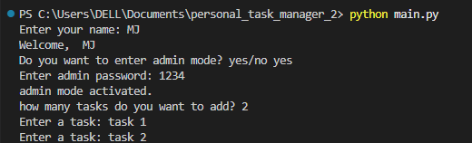
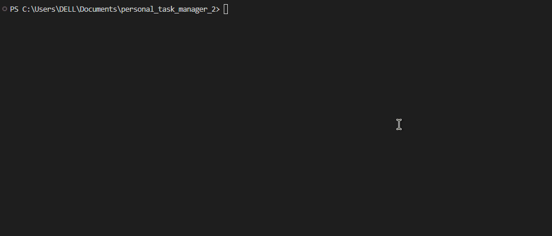

# Personal Task Manager
A simple task manager built with python

## Features
- add multiple tasks
- save tasks
- load saved tasks
- admin mode
  
## Requirements
- Python
- python-dotenv

## Installation
Install the required packages:

```bash
python -m pip install -r requirements.txt
```
## Envoirement Setup
create a `.env` file in the project folder

Use `.env.example` as a template.

Add your admin password

```env
admin_pass=your_password_here
```
replace `your_password_here` with your own admin password

## Run the Program
run the main file:
```bash
python main.py
```

## Screenshot


## Demo
