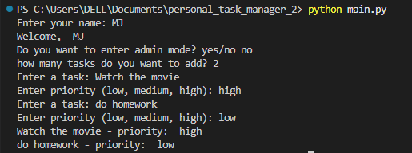
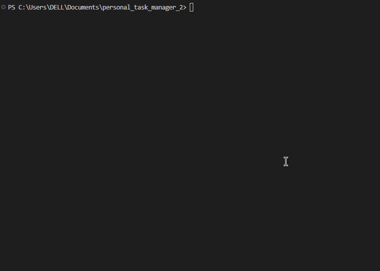

# Personal Task Manager


A simple task manager built with python for learning git and github.

## Features
- add multiple tasks
- save tasks
- load saved tasks
- admin mode

## Priority
Each task can have one of these priority levels:
- Low
- Medium
- High

## Requirements
- Python
- python-dotenv
  
## Project Structure
```text
personal_task_manager/
│   .env.example
│   .gitignore
│   main.py
│   README.md
│   requirements.txt
│   tasks.py
|
├───pictures/
│       demo.gif
│       image.png
└────────────────────
```

## Installation
Install the required packages:

```bash
python -m pip install -r requirements.txt
```
## Envoirement Setup
create a `.env` file in the project folder

Use `.env.example` as a template.

Add your admin password

```env
admin_pass=your_password_here
```
replace `your_password_here` with your own admin password

## Run the Program
run the main file:
```bash
python main.py
```

## Screenshot


## Demo
